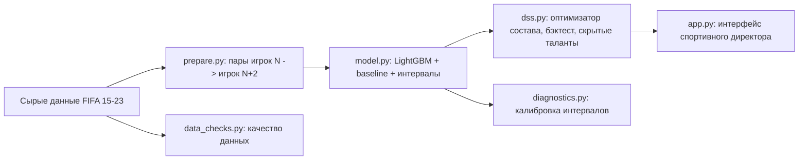

# Breakout Radar

**Как найти молодых футболистов, которые скоро вырастут, и не переплатить.**

Учебный проект по курсу «Когнитивные технологии и системы поддержки решений» (сценарий Football AI Lab / Moneyball 2.0).
Проект состоит из двух частей: прогноз роста рейтинга молодых игроков (прикладной ИИ) и система подбора состава под бюджет (поддержка решений).

---

## Содержание

1. [Простыми словами](#простыми-словами)
2. [Главные результаты](#главные-результаты)
3. [Задача и пользователь](#задача-и-пользователь)
4. [Данные](#данные)
5. [Как это работает](#как-это-работает)
6. [Структура проекта](#структура-проекта)
7. [Установка и запуск](#установка-и-запуск)
8. [Подробные результаты](#подробные-результаты)
9. [Интерактивное приложение](#интерактивное-приложение)
10. [Допущения и параметры](#допущения-и-параметры)
11. [Ловушки анализа и ограничения](#ловушки-анализа-и-ограничения)
12. [Воспроизводимость](#воспроизводимость)
13. [Что можно улучшить](#что-можно-улучшить)
14. [Данные, лицензия и авторы](#данные-лицензия-и-авторы)

---

## Простыми словами

Представьте скаута клуба с небольшим бюджетом. Ему нужны молодые игроки, которые через два года станут заметно сильнее. Игра FIFA даёт каждому игроку оценку «потенциал», но она слишком оптимистична: в среднем игроки растут намного меньше, чем обещает игра.

Мы сделали две вещи:

1. **Прогноз роста.** Модель смотрит на возраст, навыки, цену, позицию и историю игрока и предсказывает, на сколько очков вырастет его рейтинг за два года. Вместе с числом она выдаёт диапазон («в 6 случаях из 10 рост окажется между этими двумя числами»).
2. **Подбор состава.** Программа-оптимизатор выбирает из тысяч игроков лучших восьмерых так, чтобы уложиться в бюджет и лимит зарплат, а ожидаемый рейтинг через два года был максимальным.

Всё проверено «на прошлом»: выбор сделан по данным FIFA 21, а результат сравнивался с реальными рейтингами в FIFA 23.

---

## Главные результаты

| Что проверяли | Результат |
|---|---|
| Точность прогноза | Средняя ошибка 2,47 очка у нашей модели против 7,51 у оценки «потенциал − рейтинг» из игры |
| Порядок игроков | Из 100 игроков с лучшим прогнозом реально выросли на 5+ очков 61 (у оценки игры 57, у простой линейной формулы 53) |
| Подбор состава | Составы с нашим прогнозом в среднем сильнее на 0,97 очка, чем при выборе по текущему рейтингу, и на 1,19 очка, чем по оценке игры (12 сценариев) |
| Когда помогает | При бюджете от 32 млн € на 8 игроков: 8 побед из 8; при 16–20 млн € практически ничья |
| Простой выбор по потенциалу | Не уложился в бюджет в 6 из 12 сценариев; в остальных 6 заметно слабее (67,9 против 76,7 в FIFA 23) |

**Что не сработало (оставлено в проекте намеренно):**

- Вариант «с учётом риска» хуже обычного (в 9 сценариях из 12, в среднем на 0,57 очка).
- Список «скрытых талантов» не доказал превосходство над простым правилом «потенциал − рейтинг» (доверительный интервал разницы включает ноль).

**Честная оговорка:** модель объясняет примерно 15% разброса роста (R² ≈ 0,15). Это инструмент для составления шорт-листа, а не гарантия.

---

## Задача и пользователь

- **Пользователь:** спортивный директор клуба с ограниченным бюджетом.
- **Решение:** каких молодых полевых игроков купить (по умолчанию 8: 3 защитника, 3 полузащитника, 2 нападающих).
- **Вопрос исследования:** можно ли по данным сегодняшнего дня угадывать рост игроков лучше, чем это делает игровая оценка потенциала, и даёт ли такой прогноз более сильный состав при тех же деньгах?

---

## Данные

- **Источник:** [FIFA 23 complete player dataset (Kaggle, Stefano Leone)](https://www.kaggle.com/datasets/stefanoleone992/fifa-23-complete-player-dataset), файл `male_players (legacy).csv`.
- **Лицензия данных:** CC0 (общественное достояние). Данные собраны с сайта sofifa.com.
- **Охват:** версии FIFA с 15 по 23, по одной записи на игрока в каждой версии.
- **Объём:** 161 583 записи, 49 699 разных игроков.

| Параметр отбора | Значение |
|---|---|
| Возраст | до 23 лет |
| Минимальный рейтинг | 60 |
| Вратари | исключены |
| Горизонт прогноза | 2 версии игры |
| Рабочая выборка | 39 359 записей |
| Пар «сейчас → через 2 года» | 21 640 |
| Кандидатов для прогноза (FIFA 23) | 4 721 |

**Как сопоставляются игроки:** по номеру игрока (`player_id`). Разница рейтинга игрока в версии N+2 и N — целевая переменная `target`.

**Проверка качества данных** (`src/data_checks.py`):

- дубликатов нет (ни по паре «игрок и версия», ни среди целых строк);
- у 0,51% записей (202) нет цены, зарплаты, клуба и лиги — в подборе состава они не участвуют;
- у навыка «хладнокровие» (`mentality_composure`) пропущено 19,6%, у `league_level` 1,2% — модель обрабатывает пропуски сама;
- потенциал нигде не ниже рейтинга, навыки в диапазоне 0–100;
- цены и зарплаты имеют тяжёлый «хвост» (звёзды, максимум 194 млн €) — это настоящие значения, поэтому оставлены, а в модель подаются в логарифме;
- скачки рейтинга на 12 и более очков за 2 года у 1,8% пар, все — рост (самое сильное падение −9).

---

## Как это работает



### 1. Подготовка данных (`src/prepare.py`)

- Для каждой версии N находит тех же игроков в версии N+2.
- Добавляет признаки: разрыв `potential − overall`, логарифм цены и зарплаты, изменение рейтинга и потенциала за прошлый год, группа позиции.
- Сохраняет долю игроков, найденных через два года (смещение выжившего), в `data/survivorship.csv`.

### 2. Прогнозная модель (`src/model.py`)

- **Модель:** LightGBM для среднего прироста и две модели квантилей (q20 и q80) для диапазона.
- **Признаки:** возраст, рейтинг, потенциал, цена, зарплата, рост и вес, слабая нога, умения, международная репутация, уровень лиги, около 35 игровых навыков, изменение за год, позиция, предпочитаемая нога, лига.
- **Проверка по времени (walk-forward):**
  - `dev`: обучение на версиях 15–16, проверка на версии 18;
  - `test`: обучение на версиях 15–19, проверка на версии 21 (цель: FIFA 23).
- **Baseline-правила для сравнения:**
  - B0 — нулевой рост;
  - B1 — «потенциал − рейтинг» (оценка самой игры);
  - B2 — средний рост по возрасту и группе позиции;
  - B3 — линейная регрессия на 4 признаках.
- **Финальная модель** обучается на всех парах, цель которых известна (версии ≤ 21), и делает прогноз для FIFA 23 → FIFA 25.

### 3. Система подбора состава (`src/dss.py`)

- **Оптимизатор** (`scipy.optimize.milp`) максимизирует сумму `overall + прогноз роста` при ограничениях: бюджет, лимит зарплат, число игроков по линиям (защита, середина, атака).
- **Методы, которые сравниваются:**
  - A — простой выбор по `potential` (жадный перебор);
  - B — оптимизатор + оценка игры (`potential − overall`);
  - C — оптимизатор + наш прогноз;
  - D — оптимизатор + наш прогноз с учётом риска (смесь среднего и q20);
  - E — оптимизатор только по текущему рейтингу.
- **Бэктест:** решение по данным FIFA 21, оценка по реальным рейтингам FIFA 23. 12 сценариев: схемы 3-3-2 и 2-3-3, бюджеты 16, 20, 32, 40, 64, 80 млн €.
- **Скрытые таланты:** молодые недорогие игроки, у которых прогноз роста выше типичного для их возраста и позиции (с учётом нижнего квантиля q20), плюс проверка этого правила на прошлом.

### 4. Диагностика (`src/diagnostics.py`)

Проверяет, как часто реальный прирост попадает в диапазон модели, и по группам рейтинга, возраста и позиции.

---

## Структура проекта

```
football-breakout-radar/
├── app.py                      # интерфейс Streamlit
├── README.md
├── requirements.txt            # зависимости (см. раздел «Установка»)
├── src/
│   ├── prepare.py              # этап 1: подготовка данных
│   ├── model.py                # этап 2: прогнозная модель и проверка
│   ├── dss.py                  # этап 3: оптимизатор, бэктест, скрытые таланты
│   ├── diagnostics.py          # калибровка квантилей
│   └── data_checks.py          # проверка качества данных
├── data/                       # данные (не хранятся в репозитории)
│   ├── male_players_legacy.csv # скачивается с Kaggle
│   ├── pairs.csv               # создаёт prepare.py
│   ├── candidates_fifa23.csv   # создаёт prepare.py
│   └── survivorship.csv        # создаёт prepare.py
└── results/                    # результаты запусков
    ├── metrics.csv
    ├── feature_importance.csv
    ├── mae_by_league.csv
    ├── mae_by_position.csv
    ├── test_predictions_fifa21_to_23.csv
    ├── candidates_with_forecast.csv
    ├── model.joblib
    ├── features.json
    ├── backtest.csv
    ├── backtest_summary.csv
    ├── backtest_pairwise.csv
    ├── backtest_vs_A.csv
    ├── hidden_gems.csv
    ├── gems_backtest.csv
    ├── gems_backtest_diff.csv
    ├── quantile_calibration.csv
    ├── data_quality_missing.csv
    └── data_quality_ranges.csv
```

---

## Установка и запуск

### 1. Окружение

```bash
python -m venv .venv
# Windows (PowerShell):
.venv\Scripts\Activate.ps1
# macOS / Linux:
source .venv/bin/activate

pip install pandas numpy scipy scikit-learn lightgbm joblib streamlit
```

Если нужен файл зависимостей с точными версиями, выполните `pip freeze > requirements.txt` после установки.

### 2. Данные

1. Скачайте набор с [Kaggle](https://www.kaggle.com/datasets/stefanoleone992/fifa-23-complete-player-dataset).
2. Положите файл `male_players (legacy).csv` в папку `data/` и переименуйте в `male_players_legacy.csv`.

### 3. Запуск (все команды из корня проекта)

```bash
python src/data_checks.py     # проверка качества данных
python src/prepare.py         # пары «игрок N -> игрок N+2», кандидаты
python src/model.py           # обучение, baseline, интервалы, метрики
python src/dss.py             # оптимизатор, бэктест, скрытые таланты
python src/diagnostics.py     # калибровка квантилей (после model.py)
streamlit run app.py          # интерактивное приложение
```

Порядок важен: `model.py` использует файлы из `prepare.py`, а `dss.py` и приложение используют результаты `model.py`.

---

## Подробные результаты

### Качество прогноза (тест: FIFA 21 → FIFA 23, 3 116 игроков)

| Способ прогноза | Средняя ошибка (MAE) | Корреляция порядка (Spearman) | Прорывы среди топ-100 |
|---|---|---|---|
| B0: нулевой рост | 3,23 | — | 9% |
| B1: «потенциал − рейтинг» (оценка игры) | 7,51 | 0,30 | 57% |
| B2: средний рост по возрасту и позиции | 2,67 | 0,24 | 48% |
| B3: линейная регрессия (4 признака) | 2,57 | 0,37 | 53% |
| **LightGBM (наша модель)** | **2,47** | **0,41** | **61%** |

«Прорыв» — рост рейтинга на 5 очков и больше за 2 года.

- R² модели на тесте около 0,15: большая часть разброса не объясняется.
- На раннем проверочном сезоне (FIFA 18 → 20) по доле прорывов в топ-100 модель не лучше простых правил (0,49 против 0,50–0,53). Итоговое сравнение сделано на одном тестовом сезоне.

### Диапазоны прогноза [q20, q80]

| Показатель | Факт | Ожидалось |
|---|---|---|
| Реальный прирост ≥ q20 | 0,850 | 0,80 |
| Реальный прирост ≤ q80 | 0,751 | 0,80 |
| В диапазоне [q20, q80] | 0,601 | 0,60 |

Итоговое покрытие 60,1% получилось за счёт компенсации: нижняя граница слегка консервативна, верхняя занижена (особенно для слабых и очень молодых игроков).

### Бэктест подбора состава (12 сценариев, методы B–E)

| Метод | Рейтинг в FIFA 21 | Рейтинг в FIFA 23 (реально) | Прирост | Доля игроков без роста | Потрачено, млн € |
|---|---|---|---|---|---|
| B: оптимизатор + оценка игры | 67,8 | 73,7 | 5,93 | 0,07 | 40,6 |
| **C: оптимизатор + наша модель** | 72,2 | **74,9** | 2,70 | 0,55 | 41,8 |
| D: то же, с учётом риска | 72,8 | 74,3 | 1,55 | 0,72 | 41,9 |
| E: только текущий рейтинг | 73,5 | 73,9 | 0,38 | 0,82 | 41,5 |

Попарное сравнение:

| Сравнение | Доля побед | Средняя разница |
|---|---|---|
| C против E (вклад модели) | 0,75 | +0,97 |
| C против B | 0,83 | +1,19 |
| D против C (эффект осторожности) | 0,25 | −0,57 |

- При бюджете от 32 млн € C выигрывает у E во всех 8 сценариях (в среднем +1,4). При 16–20 млн € разница около 0,1: практически ничья.
- Простой метод A уложился в бюджет только в 6 сценариях из 12 (эвристика реализована нами и может не находить решение). На этих 6 сценариях рейтинг A в FIFA 23 равен 67,9, а у C — 76,7.
- 12 сценариев используют один пул игроков, поэтому они не независимы: это не статистическая значимость.

### Проверка «скрытых талантов» (FIFA 21 → FIFA 23)

| Группа | Топ | Средний реальный прирост | Доля прорывов |
|---|---|---|---|
| Наш список (gem_score) | 25 | 5,88 | 0,52 |
| Топ по «потенциал − рейтинг» | 25 | 6,16 | 0,64 |
| Весь отфильтрованный пул (367) | — | 4,61 | 0,48 |

Разница «наш список минус простое правило»: −0,28 (95% интервал от −3,28 до +1,80) для топ-25 и −0,60 (от −2,06 до +1,08) для топ-50. Интервалы включают ноль, поэтому превосходство не доказано.

### Пример рекомендации (бюджет 60 млн €, схема 3-3-2, возраст до 21 года, рейтинг от 62, без поправки на риск)

| Игрок | Возраст | Позиция | Клуб | Рейтинг / потенциал | Прогноз роста | Цена, млн € |
|---|---|---|---|---|---|---|
| T. Livramento | 19 | RB | Southampton | 75 / 85 | +2,6 | 11,5 |
| A. Onana | 20 | CDM | Everton | 74 / 84 | +2,6 | 8,5 |
| N. Zalewski | 20 | LM | Roma | 74 / 86 | +2,9 | 10,0 |
| A. Bella Kotchap | 20 | CB | Southampton | 73 / 83 | +3,0 | 6,0 |
| R. Cherki | 18 | LW | Olympique Lyonnais | 73 / 88 | +3,4 | 7,0 |
| M. Thiaw | 20 | CB | Milan | 72 / 83 | +3,6 | 4,8 |
| B. Šeško | 19 | ST | Salzburg | 72 / 85 | +4,7 | 5,5 |
| F. Miretti | 18 | CM | Juventus | 72 / 87 | +4,7 | 5,5 |

Потрачено 58,8 млн €, зарплаты 180 тыс. € в неделю. Средний рейтинг около 73,1 сейчас, прогноз 76,6 через 2 года (в среднем +3,4).

Чувствительность к бюджету (средний прогнозируемый рейтинг через 2 года): 36 млн € — 75,40; 48 млн € — 76,08; 60 млн € — 76,57; 72 млн € — 76,98.

---

## Интерактивное приложение

Запуск: `streamlit run app.py`, затем откройте http://localhost:8501.

**Вкладки:**

- **Подбор состава.** Слева задаются параметры клуба: бюджет, лимит зарплат, число игроков по линиям, осторожность (0 — ожидаемый рост, 1 — пессимистичный сценарий), максимальный возраст, минимальный рейтинг, лиги. Справа — рекомендованный состав, суммарные показатели, сравнение с простым выбором по потенциалу и таблица чувствительности к бюджету (60%, 80%, 100% и 120% от заданного).
- **Качество модели.** Метрики и baseline, бэктест, попарные сравнения, важность признаков.
- **Скрытые таланты.** Список игроков и честная проверка правила на прошлом.

**Рекомендуемые параметры по результатам бэктеста:** осторожность 0.0 (вариант C).

**Важно:** позиции учитываются по трём линиям (защита, середина, атака). Приложение подбирает набор игроков по линиям, но не гарантирует сбалансированную схему по флангам и центру.

---

## Допущения и параметры

| Параметр | Значение | Где задаётся |
|---|---|---|
| Горизонт прогноза | 2 версии игры | `prepare.py` (`HORIZON`) |
| Максимальный возраст | 23 | `prepare.py` (`MAX_AGE`) |
| Минимальный рейтинг | 60 | `prepare.py` (`MIN_OVERALL`) |
| Порог «прорыва» | +5 очков за 2 года | `model.py` (`BREAKOUT`) |
| Размер топа для метрик | 100 | `model.py` (`TOP_K`) |
| Лимит недельных зарплат | 0,4% от бюджета | `dss.py` (`WAGE_RATIO`) — допущение |
| Минимальный рейтинг «таланта» | 62 | `dss.py` (`GEM_MIN_OVERALL`) — допущение |
| Вес нижнего квантиля в gem_score | 0,5 | `dss.py` (`GEM_Q20_WEIGHT`) — допущение |
| Осторожность в методе D | 0,5 | `dss.py` (`run_methods`) |
| Параметры LightGBM | 400 деревьев, скорость 0,03, 15 листьев, `random_state=42` | `model.py` (`PARAMS`) |

Параметры LightGBM не подбирались по результатам теста. Пороги и вес в списке талантов выбраны вручную.

---

## Ловушки анализа и ограничения

| Ловушка | Что сделано |
|---|---|
| Утечка информации из будущего | Проверка по времени: модель обучается только на парах, цель которых известна на момент прогноза |
| Смещение выжившего | Через 2 года в базе остаётся 70–77% игроков; ушедшие не входят в обучение и тест. Средний прирост (2,6) может быть завышен, бэктест чуть оптимистичен. Поправка не вводилась |
| Разные позиции | Вратари исключены; группа позиции — признак модели; ошибки посчитаны по линиям (`mae_by_position.csv`) |
| Разные лиги | Лига — признак модели; ошибки по лигам посчитаны отдельно (`mae_by_league.csv`) |
| Неопределённость | Модель даёт диапазон; калибровка проверена в `diagnostics.py` |
| Корреляция и причинность | Прогноз показывает вероятность роста, но не объясняет причину |
| Игровое время | Не применимо: в данных нет статистики матчей, только рейтинги игры |
| Устаревшие данные | Версии игры зафиксированы; решение — FIFA 21, результат — FIFA 23 |

**Ограничения:**

- Рейтинги, цены и зарплаты — оценки игры, а не реальные трансферные суммы и статистика матчей.
- Итоговая проверка на одном тестовом сезоне; бэктест — 12 зависимых сценариев по 8 игроков.
- Верхняя граница диапазона прогноза занижена (75% вместо 80%).
- Не учитываются вратари, тактика клуба, травмы, возможность перепродажи, реальные условия трансфера.
- Позиции по трём линиям, без разделения на фланги и центр.
- Учёт риска (метод D) не улучшил результат; список «скрытых талантов» не доказал превосходство над простым правилом.

---

## Воспроизводимость

- В LightGBM зафиксировано `random_state=42`.
- Оптимизатор (`milp`) ограничен по времени 30 секунд на задачу; в редких случаях найденное решение может немного отличаться между запусками и компьютерами.
- Результаты зависят от версий библиотек (особенно LightGBM и scipy). Рекомендуется зафиксировать версии в `requirements.txt`.
- В Windows PowerShell команды запускаются из корня проекта с активированным окружением `.venv`.

---

## Что можно улучшить

- Проверить модель на нескольких тестовых сезонах (walk-forward по FIFA 19 → 21, 20 → 22, 21 → 23) и добавить доверительные интервалы.
- Откалибровать верхний квантиль q80 на отдельном сезоне.
- Придумать более рабочую меру риска, чем смесь среднего и q20, и проверить её на бэктесте.
- Добавить ограничения на конкретные позиции (левый и правый защитник, центр и фланги).
- Заменить игровые цены реальными трансферными данными и добавить стоимость перепродажи.
- Проверить прогноз FIFA 23 → FIFA 25 на реальных рейтингах, когда они будут доступны.

---

## Данные, лицензия и авторы

- **Данные:** [FIFA 23 complete player dataset](https://www.kaggle.com/datasets/stefanoleone992/fifa-23-complete-player-dataset), автор Stefano Leone, лицензия CC0. Исходные данные собраны с sofifa.com.
- **Лицензия кода:** [укажите, например MIT].
- **Авторы:** [укажите имя и контакты].
